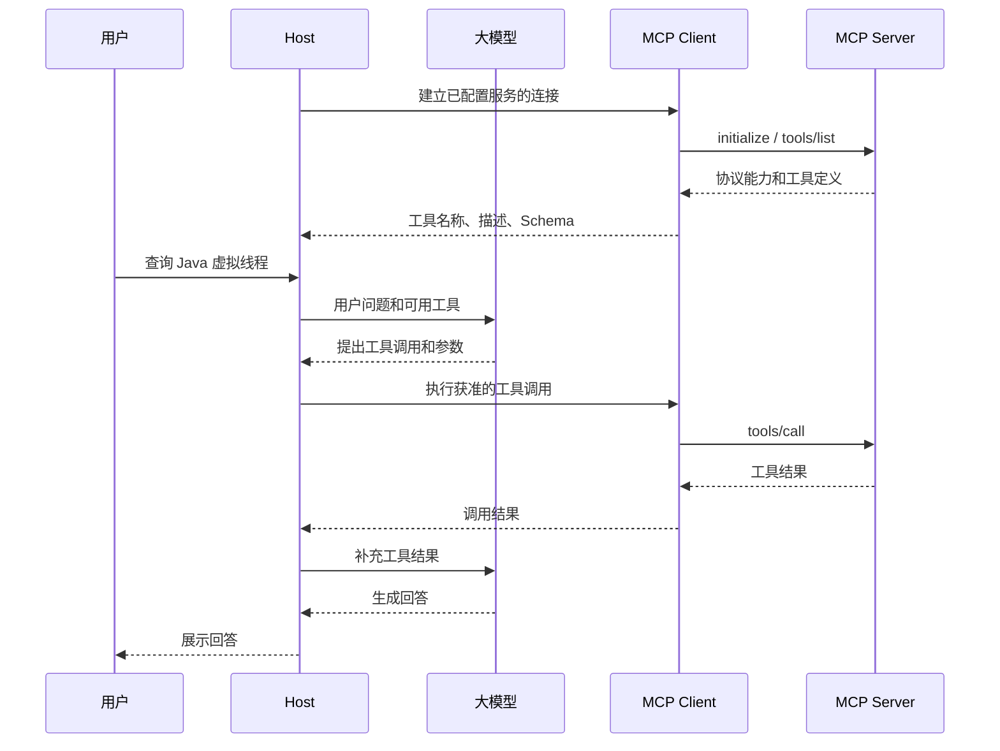

# 从一次模拟 Google 查询理解 MCP：Java 实战讲义

## 先看你将实现的行为

假设你让一个Agent查“Java 虚拟线程”。在这个教学项目里，搜索结果来自内存中的固定语料。客户端真正启动另一个Java进程，按MCP格式发送消息，然后读取结果。

你运行的是：

```powershell
java -cp .\dist\mock-google-mcp.jar demo.McpClientDemo "Java 虚拟线程" 2
```

这个程序会完成四件事：建立会话、获取工具说明、调用搜索、显示结果。它不会向Google发送请求，也不会调用大模型。结果中的`mock: true`和`[模拟]`文字是数据性质的明确标记。

这套拆分让两个问题分别可观察：协议是否正确，可以由真实消息验证；搜索是否智能，是业务函数的事情。以后换成真实搜索接口，协议部分仍然有价值。

本例使用Java17语法与标准库，明确锁定MCP `2025-06-18` 的stdio/tools子集。本次运行验证发生在Linux的OpenJDK21.0.13；没有在Windows、Java17或用户Codex实例内实测。

## 一、为什么一个搜索函数还需要 MCP

先写普通业务函数：

```java
Map<String, Object> result = MockSearch.search("Java 虚拟线程", 2);
```

同一个Java进程中的调用者知道类名、方法名和参数类型，JVM可以直接执行它。但是Codex可能不是Java程序，而且你的搜索服务可能处于另一个进程。调用者需要另外解决：去哪里连接、有什么操作、参数如何描述、请求怎么发送、结果怎么理解、失败如何表达。

MCP规定了其中的通用交互形式。`tools/list`获取可调用操作的说明，`tools/call`按名称和参数调用操作。业务实现仍由服务端自己的代码负责。[官方工具规范](https://modelcontextprotocol.io/specification/2025-06-18/server/tools)

对Java后端工程师，可以先用这个对应关系理解本例：

| Java后端中的概念 | 本例中的对应物 | 需要注意的差异 |
|---|---|---|
| 业务Service | `MockSearch.search` | 不依赖MCP |
| 请求分发器 | `McpServer.dispatch` | 按JSON-RPC的method分发 |
| 业务操作分发 | `McpServer.callTool` | 按业务工具name分发 |
| 接口说明/参数约定 | `inputSchema` | 描述输入，不是Java字节码 |
| HTTP客户端/RPC客户端 | `RpcSession` | 本例通过进程管道传输 |
| 请求关联号 | JSON-RPC `id` | 将响应关联回对应请求 |

这里的类比是帮助你定位职责，不意味着MCP与HTTP、Dubbo、OpenAPI完全等价。

## 二、Host、Client、Server、大模型的职责

Host是用户使用的应用，例如Codex。它负责与模型交互、管理工具、把模型提出的调用交给客户端执行。MCP Client负责某条连接上的协议消息；MCP Server公开工具并执行业务逻辑。[官方架构](https://modelcontextprotocol.io/specification/2025-06-18/architecture)

本例的角色非常明确：

| 角色 | 在本例中是谁 |
|---|---|
| 简化的Host逻辑 | `McpClientDemo.run`，按固定教学顺序执行 |
| MCP Client | `McpClientDemo.RpcSession` |
| MCP Server | 另一个进程中的`McpServer` |
| 搜索业务 | `MockSearch` |
| 大模型 | 没有接入；工具选择由代码固定指定 |

如果接入Codex，Codex替代本例教学客户端。模型可以根据工具说明提出调用；真正写入管道、等待响应的是Host中的MCP客户端。服务端本身不必包含LLM。

下面描述的是常见Agent工具调用流程，而本例只实际运行其中的协议部分：



图中的模型是否选择工具、怎样整合结果，属于Host与模型的配合；MCP没有规定模型必须采用哪一种推理流程。

## 三、“发现”到底发现什么

先区分两个动作。

第一个动作是找到服务端的位置。本例通过启动命令`java -jar ...`知道服务端如何运行；HTTP场景则可以通过配置知道URL。MCP不会在你电脑或互联网上自动扫描所有搜索服务。

第二个动作是连接以后询问服务端：“你提供哪些工具？”本例用`tools/list`得到`google_search`、它的说明和参数Schema。这个动作才是当前课程讨论的工具发现。

因此，`tools/list`不承担Nacos式的地址注册与查找。它读取已连接服务的工具目录。

在服务端，目录定义来自`McpServer.SEARCH_TOOL`。在客户端，目录来自这次真实请求的响应，不是客户端去读取服务器源码。服务端怎样创建目录可以是手写、注解扫描或SDK注册；传给客户端的仍然是结构化描述。

本例客户端随后在目录中找名字为`google_search`的工具。查找条件是固定程序逻辑；它验证了发现和调用的协议过程，没有验证模型自主选择工具的能力。

## 四、第一次连接：初始化的三个消息

阅读`McpClientDemo.run`的第1、2步。

客户端发出请求：

```json
{
  "jsonrpc": "2.0",
  "id": 1,
  "method": "initialize",
  "params": {
    "protocolVersion": "2025-06-18",
    "capabilities": {},
    "clientInfo": {
      "name": "java-mcp-teaching-client",
      "version": "1.0.0"
    }
  }
}
```

`protocolVersion`说明客户端支持的协议版本。`capabilities`说明可选能力；空对象表示本例客户端没有声明sampling等可选能力。`clientInfo`只是实现信息，不能把其中的name当成经过认证的调用者身份。

服务端返回相同的`id`，并在结果里给出版本、能力和实现信息：

```json
{
  "protocolVersion": "2025-06-18",
  "capabilities": {"tools": {}},
  "serverInfo": {
    "name": "mock-google-search-java",
    "version": "1.0.0"
  },
  "instructions": "全部结果都是教学模拟数据；本服务不会请求 Google 或其他外部服务。"
}
```

上面只展示响应的`result`内容。`tools: {}`表示提供工具能力，不代表工具名字已经传完。具体工具列表稍后由`tools/list`返回。

版本协商也不是简单地比较字符串然后一律报错。本服务端只支持一个版本：如果客户端提出别的版本，它仍返回自己支持的版本，由客户端判断是否接受。教学客户端只接受2025-06-18；官方SDK可以接受它所支持的多个版本之一。[生命周期规范](https://modelcontextprotocol.io/specification/2025-06-18/basic/lifecycle)

最后客户端发送：

```json
{"jsonrpc":"2.0","method":"notifications/initialized"}
```

这条消息没有`id`，是通知。服务端收到后把本例会话状态改为READY；不会为通知再回复一条消息。客户端如果在这里等待回复，就会把自己卡住。

`McpServer.State`的NEW、INITIALIZING、READY是本例实现的内部状态名，不是必须照搬的MCP字段。

## 五、发现工具：接口说明变成可传输的数据

客户端发送：

```json
{"jsonrpc":"2.0","id":2,"method":"tools/list","params":{}}
```

服务端通过`dispatch`返回工具目录。为了突出结构，下面省略description的具体中文，其他约束与源码一致：

```json
{
  "name": "google_search",
  "description": "教学用模拟 Google 搜索",
  "inputSchema": {
    "type": "object",
    "properties": {
      "query": {"type": "string", "minLength": 1, "pattern": "\\S"},
      "limit": {"type": "integer", "minimum": 1, "maximum": 5, "default": 3}
    },
    "required": ["query"],
    "additionalProperties": false
  }
}
```

这里有三个层次：name是程序调用使用的准确标识，description帮助调用者理解用途，inputSchema约束参数结构。`query`必填，`limit`可选；本例服务端在省略limit时主动填3。

要特别注意：JSON Schema中的default是描述信息，不能指望只写了default就自动补值。手写服务端还必须实际实现默认值和校验。你可以在`callTool`中找到`rawLimit`与`requireLimit`，这才是本例执行默认值和范围检查的位置。

客户端此时拿到的是说明书，不是可在本机执行的Java函数对象，也不是搜索结果。真正的执行发生在下一步。[工具规范](https://modelcontextprotocol.io/specification/2025-06-18/server/tools)

## 六、调用工具：看清两层名字

调用消息如下：

```json
{
  "jsonrpc": "2.0",
  "id": 3,
  "method": "tools/call",
  "params": {
    "name": "google_search",
    "arguments": {"query": "Java 虚拟线程", "limit": 2}
  }
}
```

`method`是协议方法，`params.name`是业务工具名。新增一个`get_weather`工具时，调用它的method仍然是`tools/call`。

这对应源码中的两层分发：

```java
// 第一层：MCP标准方法。
case "tools/call" -> {
    requireReady();
    yield callTool(params);
}
```

```java
// 第二层：业务工具。
String name = requireString(params.get("name"), "name");
if (!"google_search".equals(name)) {
    throw new RpcFailure(-32602, "Unknown tool: " + name);
}
```

在取出并校验query、limit之后，才调用普通Java业务方法：

```java
Map<String, Object> data = MockSearch.search(query, limit);
```

工具名并不要求与Java方法名相同。本例对外名字是`google_search`，Java方法叫`search`。两者之间的映射由服务端建立。

## 七、业务函数完全可以不认识 MCP

`MockSearch`包含6条模拟语料，每条有title、url、snippet和只用于匹配的tags。规则只是查询词按空白分开后全部出现在文档文本中，不是Google算法，也没有模拟Google排序质量。

以`Java 虚拟线程`为例，固定语料匹配3条，limit=2截取前2条。业务返回值中：

```json
{
  "query": "Java 虚拟线程",
  "mock": true,
  "totalMatches": 3,
  "results": [
    {
      "title": "[模拟] Java 虚拟线程入门",
      "url": "https://example.invalid/mock/java-virtual-threads",
      "snippet": "[模拟摘要] 一篇介绍Java虚拟线程基本概念的教学文档。"
    },
    {
      "title": "[模拟] Spring Boot 使用 Java 虚拟线程",
      "url": "https://example.invalid/mock/spring-boot-virtual-threads",
      "snippet": "[模拟摘要] 一篇介绍Spring Boot中虚拟线程使用方法的教学文档。"
    }
  ]
}
```

这些都是本项目定义的业务字段，不是MCP要求所有搜索工具必须使用的字段。示例URL故意使用不可用的演示域名，不应作为可访问资料来源。

如果未来接真实搜索API，最直接的改动位置就是这里：把本地匹配替换成HTTP调用，再把上游响应映射成你定义的业务结果。那时才需要真实凭证、网络超时和上游错误处理；`tools/list`与`tools/call`的核心流程不因搜索供应商改变。

## 八、为什么结果中有content，也有structuredContent

服务端把业务结果放进MCP结果对象：

```java
return object(
    "content", List.of(object("type", "text", "text", Json.stringify(data))),
    "structuredContent", data,
    "isError", false
);
```

`content`可以由多个内容块组成。本例只有一个文本块，其中text是一段序列化JSON。`structuredContent`则直接保存JSON对象，程序不用先解析字符串就能取业务字段。两处来自同一份data，避免发生数值不一致。

MCP 2025-06-18建议结构化结果同时提供文本表示以兼容旧客户端。工具也可以声明outputSchema，但本例未加入，以便把学习重点放在调用过程。[结构化结果规范](https://modelcontextprotocol.io/specification/2025-06-18/server/tools#structured-content)

不要混淆三层结果：JSON-RPC外层`result`表示请求正常完成；里面的`isError`表示工具是否执行失败；业务里的`results`表示搜索命中集合。即便第一层成功，第二层仍可能失败；搜索集合为空也不必是失败。

## 九、错误为什么分两层

本例按发生位置划分错误：在协议分发和参数检查阶段发现的问题，返回JSON-RPC error；进入MockSearch后的模拟上游失败，返回工具结果里的isError。

| 输入/情况 | 本例处理 | 含义 |
|---|---|---|
| 非法JSON | `error.code=-32700` | 连消息都无法解析 |
| 非法请求信封 | `error.code=-32600` | 不是正确的请求结构 |
| 未知method | `error.code=-32601` | 找不到协议处理方法 |
| 未知工具/参数不符合约束 | `error.code=-32602` | 调用尚未进入搜索业务 |
| 初始化未完成就列工具 | `error.code=-32002` | 本例自定义状态错误 |
| `query=__timeout__` | `result.isError=true` | 模拟业务执行失败 |
| 没有匹配项 | `isError=false, results=[]` | 正常搜索但零命中 |

`-32002`的具体含义由本例定义，不能把它当成MCP规定的固定错误含义。

2025-06-18工具规范列出了协议错误与执行错误两类。对于“输入有问题”，实现可能在参数结构校验或业务校验阶段发现；不要把所有输入问题强行解释为同一层。[错误规范](https://modelcontextprotocol.io/specification/2025-06-18/server/tools#error-handling)

协议错误示意：

```json
{"jsonrpc":"2.0","id":3,"error":{"code":-32602,"message":"limit 必须是1至5的整数"}}
```

模拟超时的工具结果示意：

```json
{
  "jsonrpc":"2.0",
  "id":3,
  "result":{
    "content":[{"type":"text","text":"MOCK_UPSTREAM_TIMEOUT: 模拟搜索上游超时；本次没有访问Google。"}],
    "isError":true
  }
}
```

上例是错误注入，没有真的等待远端超时。客户端自身等待响应的5秒超时属于另一个机制：服务端不回消息时，客户端结束等待并关闭会话。教学客户端未实现完整取消通知机制。

## 十、stdio并不神秘：就是两条进程管道

在`RpcSession`构造器中，客户端使用ProcessBuilder启动服务端。`process.getOutputStream()`写进子进程stdin，`process.getInputStream()`读取子进程stdout。服务端用System.in和System.out看到对应的另一端。

这是一处经常看反的地方：客户端的OutputStream，对应服务端的InputStream。判断方向时先确定“当前代码属于哪个进程”。

本例关键代码：

```java
process = new ProcessBuilder(java, "-cp", System.getProperty("java.class.path"), "demo.McpServer")
    .redirectError(ProcessBuilder.Redirect.INHERIT).start();
```

没有`redirectErrorStream(true)`，因为它会把stderr日志合并到stdout协议流。

服务器`run`中，readLine读一条消息，handle完成处理，stringify序列化成单行，再写换行并flush。JSON字符串内部如果有换行，由编码器转成`\n`，不是把一条协议消息拆成多行。

讲义为了阅读会缩进展示JSON；真实stdio发送必须保持每条消息一行。`verification/wire-transcript.jsonl`记录方向与消息，`demo-client.stdout.txt`保留实际单行文本。[stdio规范](https://modelcontextprotocol.io/specification/2025-06-18/basic/transports)

为什么日志用stderr？因为客户端会把服务端stdout的每一行作为JSON-RPC解析。写一条“服务启动成功”到stdout，就相当于在HTTP响应体前插入无关文字。

为什么客户端可以打印C→S？因为它的stdout是当前演示的控制台，不是被另一个MCP客户端读取的服务端协议管道。把教学客户端误配置成MCP服务器，就会出问题。

## 十一、请求id、顺序与退出

JSON-RPC请求带id，响应原样带回id。通知没有id，不能等通知回复。本例客户端每次加1，收到响应会检查其id与当前等待的请求是否一致。[基础消息规范](https://modelcontextprotocol.io/specification/2025-06-18/basic)

本例只允许依次发请求，因此简单地发送一条、等待一条。完整SDK可能同时处理多个请求、通知、进度、取消、服务器反向请求，通常需要维护更多状态。不要把本例的顺序读取机制误认为完整MCP实现的全部复杂度。

退出时客户端关闭写入服务器stdin的流，服务器readLine读到null后退出。客户端等2秒，必要时结束进程。本例没有发送`shutdown`或`exit`方法，因为MCP生命周期没有规定这两个专用RPC；不要混入其他协议的退出约定。[退出流程](https://modelcontextprotocol.io/specification/2025-06-18/basic/lifecycle#shutdown)

## 十二、在IDEA里怎样打断点

为了看服务端每一步，最简单的做法是在IDEA分别建立两个运行配置：客户端启动的子进程默认不会自动继承IDEA调试器。

第一轮先调试`McpClientDemo`，在`session.request("initialize",...)`、`session.request("tools/list",...)`和`session.request("tools/call",...)`处停下，看传出的Map和收到的Map。不要让断点导致响应等待超过5秒；需要时暂时调大`pending.get(5, TimeUnit.SECONDS)`的秒数再编译。

第二轮阅读服务端，重点定位`run`、`handle`、`dispatch`、`initialize`、`callTool`、`MockSearch.search`。如果要调试真实子进程，应单独配置Java远程调试参数并连接到该进程；本包未预置调试端口。也可以先观察已保存的真实协议记录，把每条method对应到分支。

不要把在客户端进程设置的断点，误认为一定能让另一个Java进程里的服务端停住。

## 十三、接入Codex后，哪些代码不再需要运行

按照README配置服务端JAR即可。JAR的Main-Class是`demo.McpServer`，所以`java -jar ...`运行服务器。Codex会负责启动、初始化、工具发现、调用与结果处理。

`McpClientDemo`只用于学习与本地验证，接入Codex后不需要再手动运行它。业务与服务端仍然保留。

配置中的`mock_google`是你给服务连接起的名字，`google_search`是该服务公开的工具名。一个服务连接可以公开多个工具，连接名称不等于工具名。[Codex配置](https://developers.openai.com/codex/mcp)

本次交付包含配置示例，没有修改用户现有配置。官方SDK互操作测试和Codex实际接入是不同的验证范围，不能互相冒充。

## 十四、改完这三个小实验，你就能判断自己是否理解了

### 实验1：修改工具说明

把SEARCH_TOOL.description改为更明确的中文，重新编译运行。观察tools/list响应里的description确实改变，而搜索数据不变。

检查点：你是否能解释“修改元数据影响调用者看到的说明，业务函数无需变化”？

### 实验2：修改默认条数

把inputSchema.limit.default改为2，同时把callTool里省略limit时的默认值也改成2。用不带limit的tools/call验证。

注意教学客户端默认始终显式传limit=3；仅运行默认客户端不能测出服务端默认值的变化。应在客户端构造arguments处暂时省略limit，或修改黑盒脚本的对应请求。

检查点：如果只改Schema，运行结果为什么可能仍然返回3条？

### 实验3：增加一个工具

设计`get_search_provider`，无业务参数，返回`provider=simulated-google`和`mock=true`。需要修改两个位置：tools/list返回的目录中增加工具定义；callTool中增加对应分发。客户端先读取目录，再选择新工具名调用。

检查点：只增加目录但不实现分发，会发生什么？只增加分发但不放进目录，又会怎样影响正常使用发现机制的客户端？

参考答案：前者可能在调用时得到Unknown tool；后者虽然手工知道名字可能调用成功，但客户端正常发现时不知道该工具存在。这说明“可发现”和“可执行”是两个必须对应的部分。

## 十五、从教学实现走向实际项目

手写此例是为了把隐含步骤展开。实际开发优先采用[官方Java MCP SDK](https://github.com/modelcontextprotocol/java-sdk)：SDK提供协议与传输层，让你集中实现工具定义和业务处理。不要把本例的零依赖JSON辅助类、单线程读写和简单状态机直接当成完整生产级MCP框架。

迁移时仍然需要你决定工具名称、参数边界、搜索供应商、返回结构和可观察错误。SDK负责的通用机制，不会替你决定这些业务约定。

理解本例后，你应能沿着一条真实消息回答：哪个进程发出了它，method和name分别是什么，哪个方法处理它，参数在哪里校验，哪一份业务结果进入了响应，客户端怎样知道它属于哪个请求，以及失败在哪一层表达。
