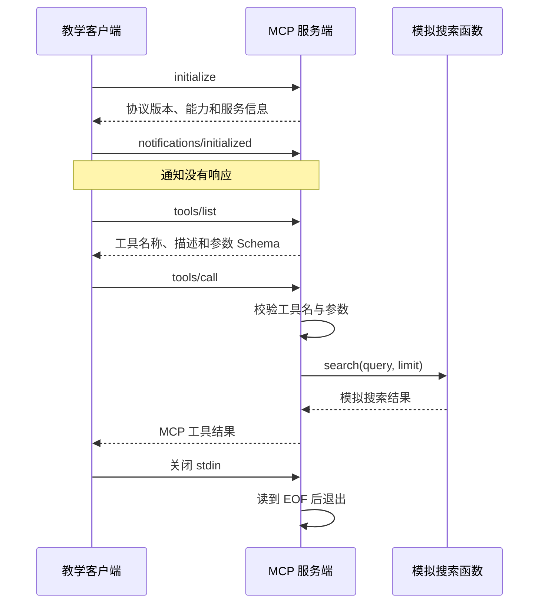

# 模拟 Google 查询 MCP：原理、工具发现与 Java 实战

这个项目用一个可离线运行的模拟搜索工具，展示 **初始化 → 工具发现 → 参数校验 → 工具执行 → 结果返回** 的完整过程。README 将运行说明与教学内容放在一起，可以边运行边沿着消息阅读 Java 代码。

**搜索数据是模拟的，两个 Java 进程之间的 MCP 通信是真实执行的。**业务只查询内存中的 6 条固定语料，不访问 Google，不需要 API Key。本地教学客户端用固定代码选择工具，没有调用大模型。

本例锁定 MCP **2025-06-18** 的 `stdio` 与 `tools` 教学子集；该日期是版本标识，不代表当前最新标准。源码使用 Java 17+ 语言/API，无第三方 Java 依赖。已验证环境与未覆盖范围见[验证记录](#13-验证记录与适用范围)。

## 阅读导航

| 你想做什么 | 阅读位置 |
|---|---|
| 先运行并观察真实消息 | [1. 先运行一次](#1-先运行一次) |
| 找到代码、构建脚本和讲义 | [2. 项目结构与阅读顺序](#2-项目结构与阅读顺序) |
| 理解为什么需要 MCP，以及各角色职责 | [3. 从普通 Java 方法理解 MCP](#3-从普通-java-方法理解-mcp)、[4. Host、Client、Server 与模型](#4-hostclientserver-与模型) |
| 分清工具发现与服务地址发现 | [5. 工具发现究竟发现什么](#5-工具发现究竟发现什么) |
| 看初始化、发现、调用的 JSON | [6. 一次完整协议交互](#6-一次完整协议交互) |
| 把消息对应到服务端和客户端代码 | [7. 服务端代码](#7-服务端代码)、[8. 客户端代码](#8-客户端代码) |
| 理解结果、错误、stdio 与退出 | [9. 结果与错误](#9-结果与错误)、[10. 通信与会话退出](#10-通信与会话退出) |
| 修改源码、编译并练习 | [11. 编译与动手实验](#11-编译与动手实验) |
| 接入本机 Codex | [12. 接入 Codex](#12-接入-codex) |
| 核对实际验证证据 | [13. 验证记录与适用范围](#13-验证记录与适用范围) |

返回[仓库目录说明](../../README.md)。

## 1. 先运行一次

仓库已包含编译好的`dist/mock-google-mcp.jar`。Java源码面向Java17+；已有运行记录的实际执行环境为 Linux 上的 OpenJDK 21.0.13，未在Windows或Java17运行时实测。

如果当前位于仓库根目录，先进入本模块：

```powershell
cd "mcp/mcp demo实践"
```

随后在本模块目录运行：

```powershell
java -version
java -cp .\dist\mock-google-mcp.jar demo.McpClientDemo "Java 虚拟线程" 2
```

客户端会自行启动服务端，并打印真实发送/收到的消息。无需提前另开一个终端运行服务端。

本客户端用固定代码选择`google_search`；`tools/list`用于读取已连接服务的工具清单，没有调用大模型。

可以观察到：

```text
C→S initialize
S→C protocolVersion=2025-06-18, capabilities.tools={}
C→S notifications/initialized
C→S tools/list
S→C tools=[google_search及其inputSchema]
C→S tools/call
S→C result.isError=false, structuredContent.mock=true
```

上面是方便阅读的摘要，不是原始协议消息。真实消息保存在[客户端日志](verification/demo-client.stdout.txt)和[协议交互记录](verification/wire-transcript.jsonl)。

默认查询匹配3条模拟语料，limit=2返回前2条。`totalMatches`是模拟语料的匹配数，不是Google全网结果数量。

更多实验：

```powershell
java -cp .\dist\mock-google-mcp.jar demo.McpClientDemo "MCP" 3
java -cp .\dist\mock-google-mcp.jar demo.McpClientDemo "肯定没有这个关键词XYZ" 3
java -cp .\dist\mock-google-mcp.jar demo.McpClientDemo "Java" 0
java -cp .\dist\mock-google-mcp.jar demo.McpClientDemo "__timeout__" 3
```

后两条故意失败，客户端进程退出码为1：分别演示参数错误与模拟业务超时。`__timeout__`会立即返回错误，不会真的等待网络超时。

## 2. 项目结构与阅读顺序

按下表顺序阅读，可以先理解业务，再理解协议如何调用业务。

| 文件或目录 | 作用 |
|---|---|
| [src/demo/MockSearch.java](src/demo/MockSearch.java) | 普通业务函数，查询固定模拟语料；不认识 MCP |
| [src/demo/McpServer.java](src/demo/McpServer.java) | 会话状态、消息解析、协议分发、工具分发和响应封装 |
| [src/demo/McpClientDemo.java](src/demo/McpClientDemo.java) | 启动子进程，完成初始化、发现和调用，打印实际消息 |
| [src/demo/Json.java](src/demo/Json.java) | 零依赖 JSON 编解码辅助类，初读时可以跳过 |
| [dist/mock-google-mcp.jar](dist/mock-google-mcp.jar) | 已编译程序，JAR 入口为 `demo.McpServer`，也包含教学客户端 |
| [build.ps1](build.ps1)、[build.sh](build.sh) | Windows 和 Linux/macOS 的源码构建脚本 |
| [codex-config.example.toml](codex-config.example.toml) | Codex 的 stdio 服务配置示例，使用前替换真实路径 |
| [verify.py](verify.py)、[verify_sdk.py](verify_sdk.py) | 独立黑盒检查与官方 Python MCP SDK 互操作检查 |
| [verification/](verification/) | 实际构建、运行、协议交互与验证记录 |
| [docs/tutorial.md](docs/tutorial.md) | 扩展讲义，包含 IDEA 调试、模型与 Host 的交互及进一步练习 |
| [docs/design.md](docs/design.md)、[实现计划](docs/develop-plan/P1-google-search-mcp.md) | 本教学实现的范围与实现记录 |

`Json.java`只是为了让例子不依赖外部 Java 库。它不是 MCP 协议的一部分；实际项目可以采用成熟 JSON 库与官方 MCP SDK。

## 3. 从普通 Java 方法理解 MCP

先写普通业务函数：

```java
Map<String, Object> result = MockSearch.search("Java 虚拟线程", 2);
```

同一个Java进程中的调用者知道类名、方法名和参数类型，JVM可以直接执行它。但是Codex可能不是Java程序，而且你的搜索服务可能处于另一个进程。调用者需要另外解决：去哪里连接、有什么操作、参数如何描述、请求怎么发送、结果怎么理解、失败如何表达。

MCP规定了其中的通用交互形式。`tools/list`获取可调用操作的说明，`tools/call`按名称和参数调用操作。业务实现仍由服务端自己的代码负责。[官方工具规范](https://modelcontextprotocol.io/specification/2025-06-18/server/tools)

对Java后端工程师，可以先用这个对应关系理解本例：

| Java后端中的概念 | 本例中的对应物 | 需要注意的差异 |
|---|---|---|
| 业务Service | `MockSearch.search` | 不依赖MCP |
| 请求分发器 | `McpServer.dispatch` | 按JSON-RPC的method分发 |
| 业务操作分发 | `McpServer.callTool` | 按业务工具name分发 |
| 接口说明/参数约定 | `inputSchema` | 描述输入，不是Java字节码 |
| HTTP客户端/RPC客户端 | `RpcSession` | 本例通过进程管道传输 |
| 请求关联号 | JSON-RPC `id` | 将响应关联回对应请求 |

这里的类比是帮助你定位职责，不意味着MCP与HTTP、Dubbo、OpenAPI完全等价。

## 4. Host、Client、Server 与模型

Host是用户使用的应用，例如Codex。它负责与模型交互、管理工具、把模型提出的调用交给客户端执行。MCP Client负责某条连接上的协议消息；MCP Server公开工具并执行业务逻辑。[官方架构](https://modelcontextprotocol.io/specification/2025-06-18/architecture)

本例的角色非常明确：

| 角色 | 在本例中是谁 |
|---|---|
| 简化的Host逻辑 | `McpClientDemo.run`，按固定教学顺序执行 |
| MCP Client | `McpClientDemo.RpcSession` |
| MCP Server | 另一个进程中的`McpServer` |
| 搜索业务 | `MockSearch` |
| 大模型 | 没有接入；工具选择由代码固定指定 |

如果接入Codex，Codex替代本例教学客户端。模型可以根据工具说明提出调用；真正写入管道、等待响应的是Host中的MCP客户端。服务端本身不必包含LLM。

本例实际执行的流程如下；接入真正 Agent 时，Host 可将工具说明交给模型，由模型提出调用，再让 MCP Client 执行。



## 5. 工具发现究竟发现什么

先区分两个动作。

第一个动作是找到服务端的位置。本例教学客户端使用`java -cp <当前classpath> demo.McpServer`启动服务端子进程；后面的 Codex 配置使用`java -jar <实际JAR路径>`启动同一个服务端。HTTP场景则可以通过配置知道URL。MCP不会在你电脑或互联网上自动扫描所有搜索服务。

第二个动作是连接以后询问服务端：“你提供哪些工具？”本例用`tools/list`得到`google_search`、它的说明和参数Schema。这个动作才是当前课程讨论的工具发现。

因此，`tools/list`不承担Nacos式的地址注册与查找。它读取已连接服务的工具目录。

在服务端，目录定义来自`McpServer.SEARCH_TOOL`。在客户端，目录来自这次真实请求的响应，不是客户端去读取服务器源码。服务端怎样创建目录可以是手写、注解扫描或SDK注册；传给客户端的仍然是结构化描述。

本例客户端随后在目录中找名字为`google_search`的工具。查找条件是固定程序逻辑；它验证了发现和调用的协议过程，没有验证模型自主选择工具的能力。

## 6. 一次完整协议交互

下面的 JSON 为方便阅读使用多行缩进；实际 `stdio` 发送时，每条消息序列化为一行。

### 6.1 初始化：请求、响应和通知

阅读`McpClientDemo.run`的第1、2步。

客户端发出请求：

```json
{
  "jsonrpc": "2.0",
  "id": 1,
  "method": "initialize",
  "params": {
    "protocolVersion": "2025-06-18",
    "capabilities": {},
    "clientInfo": {
      "name": "java-mcp-teaching-client",
      "version": "1.0.0"
    }
  }
}
```

`protocolVersion`说明客户端支持的协议版本。`capabilities`说明可选能力；空对象表示本例客户端没有声明sampling等可选能力。`clientInfo`只是实现信息，不能把其中的name当成经过认证的调用者身份。

服务端返回相同的`id`，并在结果里给出版本、能力和实现信息：

```json
{
  "protocolVersion": "2025-06-18",
  "capabilities": {"tools": {}},
  "serverInfo": {
    "name": "mock-google-search-java",
    "version": "1.0.0"
  },
  "instructions": "全部结果都是教学模拟数据；本服务不会请求 Google 或其他外部服务。"
}
```

上面只展示响应的`result`内容。`tools: {}`表示提供工具能力，不代表工具名字已经传完。具体工具列表稍后由`tools/list`返回。

版本协商也不是简单地比较字符串然后一律报错。本服务端只支持一个版本：如果客户端提出别的版本，它仍返回自己支持的版本，由客户端判断是否接受。教学客户端只接受2025-06-18；官方SDK可以接受它所支持的多个版本之一。[生命周期规范](https://modelcontextprotocol.io/specification/2025-06-18/basic/lifecycle)

最后客户端发送：

```json
{"jsonrpc":"2.0","method":"notifications/initialized"}
```

这条消息没有`id`，是通知。服务端收到后把本例会话状态改为READY；不会为通知再回复一条消息。客户端如果在这里等待回复，就会把自己卡住。

`McpServer.State`的NEW、INITIALIZING、READY是本例实现的内部状态名，不是必须照搬的MCP字段。

### 6.2 发现工具：描述输入约定

客户端发送：

```json
{"jsonrpc":"2.0","id":2,"method":"tools/list","params":{}}
```

服务端通过`dispatch`返回工具目录。为了突出结构，下面省略description的具体中文，其他约束与源码一致：

```json
{
  "name": "google_search",
  "description": "教学用模拟 Google 搜索",
  "inputSchema": {
    "type": "object",
    "properties": {
      "query": {"type": "string", "minLength": 1, "pattern": "\\S"},
      "limit": {"type": "integer", "minimum": 1, "maximum": 5, "default": 3}
    },
    "required": ["query"],
    "additionalProperties": false
  }
}
```

这里有三个层次：name是程序调用使用的准确标识，description帮助调用者理解用途，inputSchema约束参数结构。`query`必填，`limit`可选；本例服务端在省略limit时主动填3。

要特别注意：JSON Schema中的default是描述信息，不能指望只写了default就自动补值。手写服务端还必须实际实现默认值和校验。你可以在`callTool`中找到`rawLimit`与`requireLimit`，这才是本例执行默认值和范围检查的位置。

客户端此时拿到的是说明书，不是可在本机执行的Java函数对象，也不是搜索结果。真正的执行发生在下一步。[工具规范](https://modelcontextprotocol.io/specification/2025-06-18/server/tools)

### 6.3 调用工具：协议方法与业务工具名

调用消息如下：

```json
{
  "jsonrpc": "2.0",
  "id": 3,
  "method": "tools/call",
  "params": {
    "name": "google_search",
    "arguments": {"query": "Java 虚拟线程", "limit": 2}
  }
}
```

`method`是协议方法，`params.name`是业务工具名。新增一个`get_weather`工具时，调用它的method仍然是`tools/call`。

这对应源码中的两层分发：

```java
// 第一层：MCP标准方法。
case "tools/call" -> {
    requireReady();
    yield callTool(params);
}
```

```java
// 第二层：业务工具。
String name = requireString(params.get("name"), "name");
if (!"google_search".equals(name)) {
    throw new RpcFailure(-32602, "Unknown tool: " + name);
}
```

在取出并校验query、limit之后，才调用普通Java业务方法：

```java
Map<String, Object> data = MockSearch.search(query, limit);
```

工具名并不要求与Java方法名相同。本例对外名字是`google_search`，Java方法叫`search`。两者之间的映射由服务端建立。

## 7. 服务端代码

完整源码见 [McpServer.java](src/demo/McpServer.java)。抓住 `run → handle → dispatch → callTool` 这条路径，便能把收到的消息对应到实际 Java 调用。

### 7.1 `run`：读取一行，处理一条消息

下面摘自服务端源码：

```java
private void run() throws Exception {
    // stdout 是协议管道。普通日志必须写 stderr，否则客户端会把日志当 JSON 解析。
    System.err.println("[server] 模拟搜索 MCP 已启动；等待 stdin 中的 JSON-RPC 消息。");
    var input = new BufferedReader(new InputStreamReader(System.in, StandardCharsets.UTF_8));
    var output = new BufferedWriter(new OutputStreamWriter(System.out, StandardCharsets.UTF_8));
    String line;
    while ((line = input.readLine()) != null) {
        Map<String, Object> response = handle(line);
        if (response != null) {
            output.write(Json.stringify(response));
            output.write('\n');
            output.flush(); // 没有 flush，对端可能一直等不到消息。
        }
    }
    System.err.println("[server] stdin 已关闭，服务端退出。");
}
```

`handle()`解析 JSON、检查请求信封并区分请求与通知。需要响应时，外层会封装 `jsonrpc`、原请求 `id` 和 `result`；失败则封装 `error`。返回 `null` 表示通知不需要响应。

### 7.2 `dispatch`：按 MCP 方法分发

```java
private Object dispatch(String method, Map<?, ?> params) {
    return switch (method) {
        case "initialize" -> initialize(params);
        case "ping" -> object();
        case "tools/list" -> {
            requireReady();
            if (params.containsKey("cursor")) {
                throw new RpcFailure(-32602, "本例工具列表只有一页，不接受 cursor");
            }
            yield object("tools", List.of(SEARCH_TOOL));
        }
        case "tools/call" -> {
            requireReady();
            yield callTool(params);
        }
        default -> throw new RpcFailure(-32601, "Method not found: " + method);
    };
}
```

这里的 `SEARCH_TOOL` 是手写注册的工具定义。客户端从 `tools/list` 读到它，而不必依赖服务端 Java 类名。

### 7.3 `callTool`：校验后执行业务

第6.3节已经展示了按 `params.name` 分发的代码。本例在进入业务函数前检查 `arguments` 是对象、`query` 是非空白字符串、`limit` 是 1～5 的整数；未传 `limit` 时主动使用 3。

```java
Object rawLimit = arguments.containsKey("limit")
    ? arguments.get("limit")
    : 3;
int limit = requireLimit(rawLimit);

Map<String, Object> data = MockSearch.search(query, limit);
```

`object(...)`来自`Json.object(...)`静态导入，用于创建`Map<String, Object>`，并不属于 MCP 标准 API。

### 7.4 普通业务函数与模拟结果

`MockSearch`包含6条模拟语料，每条有title、url、snippet和只用于匹配的tags。规则只是查询词按空白分开后全部出现在文档文本中，不是Google算法，也没有模拟Google排序质量。

以`Java 虚拟线程`为例，固定语料匹配3条，limit=2截取前2条。业务返回值中：

```json
{
  "query": "Java 虚拟线程",
  "mock": true,
  "totalMatches": 3,
  "results": [
    {
      "title": "[模拟] Java 虚拟线程入门",
      "url": "https://example.invalid/mock/java-virtual-threads",
      "snippet": "[模拟摘要] 一篇介绍Java虚拟线程基本概念的教学文档。"
    },
    {
      "title": "[模拟] Spring Boot 使用 Java 虚拟线程",
      "url": "https://example.invalid/mock/spring-boot-virtual-threads",
      "snippet": "[模拟摘要] 一篇介绍Spring Boot中虚拟线程使用方法的教学文档。"
    }
  ]
}
```

这些都是本项目定义的业务字段，不是MCP要求所有搜索工具必须使用的字段。示例URL故意使用不可用的演示域名，不应作为可访问资料来源。

如果未来接真实搜索API，最直接的改动位置就是这里：把本地匹配替换成HTTP调用，再把上游响应映射成你定义的业务结果。那时才需要真实凭证、网络超时和上游错误处理；`tools/list`与`tools/call`的核心流程不因搜索供应商改变。

## 8. 客户端代码

完整源码见 [McpClientDemo.java](src/demo/McpClientDemo.java)。下面是源码中的主流程；连接与消息收发由内部的 `RpcSession` 实现。

```java
private static void run(String query, int limit) throws Exception {
    System.out.println("教学演示：真实 MCP 进程通信 + 模拟搜索数据；不调用大模型。");
    try (RpcSession session = new RpcSession()) {
        // 1. 客户端声明自己支持的版本和能力，检查服务端选择的版本。
        Map<String, Object> initialized = session.request("initialize", Json.object(
            "protocolVersion", PROTOCOL_VERSION,
            "capabilities", Json.object(),
            "clientInfo", Json.object("name", "java-mcp-teaching-client", "version", "1.0.0")));
        if (!PROTOCOL_VERSION.equals(initialized.get("protocolVersion"))) {
            throw new IOException("客户端不支持服务端选择的协议版本：" + initialized.get("protocolVersion"));
        }
        Map<String, Object> capabilities = object(initialized.get("capabilities"));
        if (!(capabilities.get("tools") instanceof Map<?, ?>)) {
            throw new IOException("服务端没有声明 tools 能力");
        }

        // 2. 通知没有 id，也没有响应；这里绝不能再调用 readLine() 等回复。
        session.notify("notifications/initialized");

        // 3. 从实际服务端发现工具。这个例子只需要一页静态工具列表。
        Map<String, Object> listing = session.request("tools/list", Json.object());
        if (listing.get("nextCursor") != null) throw new IOException("教学客户端未实现工具列表分页");
        if (!(listing.get("tools") instanceof List<?> tools)) throw new IOException("tools 必须是数组");
        Map<String, Object> selected = null;
        for (Object item : tools) {
            Map<String, Object> tool = object(item);
            System.out.println("[发现工具] " + tool.get("name"));
            System.out.println("  用途：" + tool.get("description"));
            System.out.println("  参数：" + Json.stringify(tool.get("inputSchema")));
            if ("google_search".equals(tool.get("name"))) selected = tool;
        }
        if (selected == null) throw new IOException("服务端实际返回的工具列表中没有 google_search");

        // 4. 本例固定选择搜索工具，但调用名取自 tools/list 的真实返回值。
        Map<String, Object> result = session.request("tools/call", Json.object(
            "name", selected.get("name"),
            "arguments", Json.object("query", query, "limit", limit)));
        if (!(result.get("content") instanceof List<?>)) throw new IOException("工具结果缺少 content 数组");
        if (result.containsKey("isError") && !(result.get("isError") instanceof Boolean)) {
            throw new IOException("isError 必须是布尔值");
        }
        if (Boolean.TRUE.equals(result.get("isError"))) {
            throw new IOException("工具执行失败（isError=true）：" + Json.stringify(result.get("content")));
        }
        System.out.println("[搜索成功，数据为模拟] " + Json.stringify(
            result.containsKey("structuredContent") ? result.get("structuredContent") : result.get("content")));
    }
}
```

留意 `selected.get("name")`：调用名来自本次 `tools/list` 的返回结果。不过，选择条件 `"google_search".equals(...)` 是固定代码，不是模型自主决策。

`RpcSession.request()`为请求分配递增 `id`，发送后最多等待 5 秒，再检查响应的 `jsonrpc`、`id` 与 `result/error`。完整 SDK 还需要处理本例未覆盖的并发请求、主动通知和取消等情况。

## 9. 结果与错误

### 9.1 文本结果与结构化结果

服务端把业务结果放进MCP结果对象：

```java
return object(
    "content", List.of(object("type", "text", "text", Json.stringify(data))),
    "structuredContent", data,
    "isError", false
);
```

`content`可以由多个内容块组成。本例只有一个文本块，其中text是一段序列化JSON。`structuredContent`则直接保存JSON对象，程序不用先解析字符串就能取业务字段。两处来自同一份data，避免发生数值不一致。

MCP 2025-06-18建议结构化结果同时提供文本表示以兼容旧客户端。工具也可以声明outputSchema，但本例未加入，以便把学习重点放在调用过程。[结构化结果规范](https://modelcontextprotocol.io/specification/2025-06-18/server/tools#structured-content)

不要混淆三层结果：JSON-RPC外层`result`表示请求正常完成；里面的`isError`表示工具是否执行失败；业务里的`results`表示搜索命中集合。即便第一层成功，第二层仍可能失败；搜索集合为空也不必是失败。

### 9.2 协议错误与工具执行错误

本例按发生位置划分错误：在协议分发和参数检查阶段发现的问题，返回JSON-RPC error；进入MockSearch后的模拟上游失败，返回工具结果里的isError。

| 输入/情况 | 本例处理 | 含义 |
|---|---|---|
| 非法JSON | `error.code=-32700` | 连消息都无法解析 |
| 非法请求信封 | `error.code=-32600` | 不是正确的请求结构 |
| 未知method | `error.code=-32601` | 找不到协议处理方法 |
| 未知工具/参数不符合约束 | `error.code=-32602` | 调用尚未进入搜索业务 |
| 初始化未完成就列工具 | `error.code=-32002` | 本例自定义状态错误 |
| `query=__timeout__` | `result.isError=true` | 模拟业务执行失败 |
| 没有匹配项 | `isError=false, results=[]` | 正常搜索但零命中 |

`-32002`的具体含义由本例定义，不能把它当成MCP规定的固定错误含义。

2025-06-18工具规范列出了协议错误与执行错误两类。对于“输入有问题”，实现可能在参数结构校验或业务校验阶段发现；不要把所有输入问题强行解释为同一层。[错误规范](https://modelcontextprotocol.io/specification/2025-06-18/server/tools#error-handling)

协议错误示意：

```json
{"jsonrpc":"2.0","id":3,"error":{"code":-32602,"message":"limit 必须是1至5的整数"}}
```

模拟超时的工具结果示意：

```json
{
  "jsonrpc":"2.0",
  "id":3,
  "result":{
    "content":[{"type":"text","text":"MOCK_UPSTREAM_TIMEOUT: 模拟搜索上游超时；本次没有访问Google。"}],
    "isError":true
  }
}
```

上例是错误注入，没有真的等待远端超时。客户端自身等待响应的5秒超时属于另一个机制：服务端不回消息时，客户端结束等待并关闭会话。教学客户端未实现完整取消通知机制。

可以用第1节中的正常查询、参数错误和模拟超时示例，分别观察正常结果、`limit=0`的参数错误和`__timeout__`的业务错误。无匹配项时仍是成功调用，`results=[]`。

## 10. 通信与会话退出

在`RpcSession`构造器中，客户端使用ProcessBuilder启动服务端。`process.getOutputStream()`写进子进程stdin，`process.getInputStream()`读取子进程stdout。服务端用System.in和System.out看到对应的另一端。

这是一处经常看反的地方：客户端的OutputStream，对应服务端的InputStream。判断方向时先确定“当前代码属于哪个进程”。

本例关键代码：

```java
process = new ProcessBuilder(java, "-cp", System.getProperty("java.class.path"), "demo.McpServer")
    .redirectError(ProcessBuilder.Redirect.INHERIT).start();
```

没有`redirectErrorStream(true)`，因为它会把stderr日志合并到stdout协议流。

服务器`run`中，readLine读一条消息，handle完成处理，stringify序列化成单行，再写换行并flush。JSON字符串内部如果有换行，由编码器转成`\n`，不是把一条协议消息拆成多行。

讲义为了阅读会缩进展示JSON；真实stdio发送必须保持每条消息一行。`verification/wire-transcript.jsonl`记录方向与消息，`demo-client.stdout.txt`保留实际单行文本。[stdio规范](https://modelcontextprotocol.io/specification/2025-06-18/basic/transports)

为什么日志用stderr？因为客户端会把服务端stdout的每一行作为JSON-RPC解析。写一条“服务启动成功”到stdout，就相当于在HTTP响应体前插入无关文字。

为什么客户端可以打印C→S？因为它的stdout是当前演示的控制台，不是被另一个MCP客户端读取的服务端协议管道。把教学客户端误配置成MCP服务器，就会出问题。

### 请求关联与关闭连接

JSON-RPC请求带id，响应原样带回id。通知没有id，不能等通知回复。本例客户端每次加1，收到响应会检查其id与当前等待的请求是否一致。[基础消息规范](https://modelcontextprotocol.io/specification/2025-06-18/basic)

本例只允许依次发请求，因此简单地发送一条、等待一条。完整SDK可能同时处理多个请求、通知、进度、取消、服务器反向请求，通常需要维护更多状态。不要把本例的顺序读取机制误认为完整MCP实现的全部复杂度。

退出时客户端关闭写入服务器stdin的流，服务器readLine读到null后退出。客户端等2秒，必要时结束进程。本例没有发送`shutdown`或`exit`方法，因为MCP生命周期没有规定这两个专用RPC；不要混入其他协议的退出约定。[退出流程](https://modelcontextprotocol.io/specification/2025-06-18/basic/lifecycle#shutdown)

## 11. 编译与动手实验

需要完整JDK17+；无需Maven、Gradle或第三方依赖。

Windows PowerShell：

```powershell
.\build.ps1
java -cp .\dist\mock-google-mcp.jar demo.McpClientDemo "Java 虚拟线程" 2
```

也可直接执行相同的编译命令，无需运行脚本：

```powershell
javac --release 17 -encoding UTF-8 -d out src/demo/*.java
jar --create --file dist/mock-google-mcp.jar --main-class demo.McpServer -C out .
```

Linux/macOS（完整JDK17+）：

```bash
sh build.sh
java -cp dist/mock-google-mcp.jar demo.McpClientDemo 'Java 虚拟线程' 2
```

### 三个练习

#### 实验1：修改工具说明

把SEARCH_TOOL.description改为更明确的中文，重新编译运行。观察tools/list响应里的description确实改变，而搜索数据不变。

检查点：你是否能解释“修改元数据影响调用者看到的说明，业务函数无需变化”？

#### 实验2：修改默认条数

把inputSchema.limit.default改为2，同时把callTool里省略limit时的默认值也改成2。用不带limit的tools/call验证。

注意教学客户端默认始终显式传limit=3；仅运行默认客户端不能测出服务端默认值的变化。应在客户端构造arguments处暂时省略limit，或修改黑盒脚本的对应请求。

检查点：如果只改Schema，运行结果为什么可能仍然返回3条？

#### 实验3：增加一个工具

设计`get_search_provider`，无业务参数，返回`provider=simulated-google`和`mock=true`。需要修改两个位置：tools/list返回的目录中增加工具定义；callTool中增加对应分发。客户端先读取目录，再选择新工具名调用。

检查点：只增加目录但不实现分发，会发生什么？只增加分发但不放进目录，又会怎样影响正常使用发现机制的客户端？

参考答案：前者可能在调用时得到Unknown tool；后者虽然手工知道名字可能调用成功，但客户端正常发现时不知道该工具存在。这说明“可发现”和“可执行”是两个必须对应的部分。

## 12. 接入 Codex

先确认JAR实际路径，例如`D:/projects/Agent_Interview/mcp/mcp demo实践/dist/mock-google-mcp.jar`。

把`codex-config.example.toml`中的示例路径改为实际绝对路径，再将对应配置合并到`~/.codex/config.toml`：

```toml
[mcp_servers.mock_google]
command = "java"
args = ["-jar", "D:/projects/Agent_Interview/mcp/mcp demo实践/dist/mock-google-mcp.jar"]
```

重新启动Codex后用`/mcp`检查服务，再要求模型：

```text
调用mock_google服务的google_search工具，query为Java 虚拟线程，limit为2。
结果属于模拟数据，请原样说明这一点。
```

这里由Codex承担Host与MCP Client的工作。不要把`McpClientDemo`配置成服务器：它会向控制台输出讲解文字，这些不是服务端协议消息。

配置中的`mock_google`是服务连接名，`google_search`是服务公开的工具名。一个服务可以提供多个工具。

仓库包含配置示例，实际使用前需在自己的环境配置。现有验证没有覆盖用户本机 Codex 加载；SDK 互操作与 Codex 端到端验证属于不同范围。

## 13. 验证记录与适用范围

现有验证记录显示：Python标准库黑盒检查32/32通过；官方Python MCP SDK 1.29.0互操作检查7/7通过。两者调用的都是仓库中的同一个 JAR，验证范围是本教学子集，不是完整规范认证或用户端Codex验收。

- [verification/build.log](verification/build.log)：实际编译命令及输出。
- [verification/demo-client.stdout.txt](verification/demo-client.stdout.txt)：Java教学客户端完整运行日志。
- [verification/demo-server.stderr.txt](verification/demo-server.stderr.txt)：隔离后的服务端日志。
- [verification/verification-report.json](verification/verification-report.json)：独立Python标准库客户端的黑盒检查结果。
- [verification/sdk-report.json](verification/sdk-report.json)：官方Python MCP SDK互操作结果。
- [verification/wire-transcript.jsonl](verification/wire-transcript.jsonl)：黑盒验证真实请求/响应记录。

重新运行黑盒检查需要Python3.10+：

```powershell
python verify.py
```

重新运行可选SDK互操作检查还需要`mcp` Python包；交付环境使用的是`mcp==1.29.0`：

```powershell
python verify_sdk.py
```

上述记录来自教学工程交付时的实际运行：Linux、OpenJDK 21.0.13、Python 3.12.14。编译采用 Java 17 语言与目标字节码；没有在 Java 17 运行时或 Windows 上实测。

实现范围为单工具、顺序请求、stdio 通信。HTTP、鉴权、分页、并发、取消、动态工具变化、resources、prompts、sampling 均未实现；通过现有检查不代表完整 MCP 规范认证。

## 14. 进一步阅读与官方参考

需要进一步调试时，可阅读[扩展讲义](docs/tutorial.md)中关于 IDEA 断点、子进程和调试等待时间的说明。希望从手写协议转向实际项目时，可参考[官方 Java MCP SDK](https://github.com/modelcontextprotocol/java-sdk)，继续保留你设计的工具说明、参数边界与业务返回约定。

- [MCP架构](https://modelcontextprotocol.io/specification/2025-06-18/architecture)
- [生命周期](https://modelcontextprotocol.io/specification/2025-06-18/basic/lifecycle)
- [stdio传输](https://modelcontextprotocol.io/specification/2025-06-18/basic/transports)
- [工具与错误](https://modelcontextprotocol.io/specification/2025-06-18/server/tools)
- [Java SDK](https://github.com/modelcontextprotocol/java-sdk)
- [Python SDK](https://github.com/modelcontextprotocol/python-sdk)
- [Codex MCP配置](https://developers.openai.com/codex/mcp)
