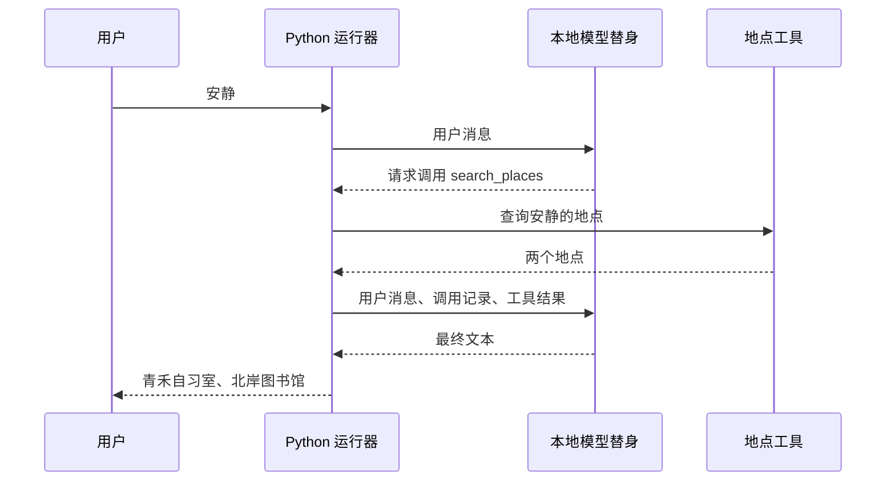

# 跟着一次工具调用学 Python

在终端里输入「安静」，屏幕上会出现「青禾自习室、北岸图书馆」。如果把同一份程序切到流式模式，你还会看见它先报告准备调用哪个工具，再报告查到了什么，最后才给出这句话。**这两个地点最早出现在哪一步？模型又是在哪一步读到它们的？** 这门课用一个可以逐行运行的 Python 程序回答这两个问题。

课程适合熟悉 Java、初次读 Python Agent 源码的开发者。OpenAI 的《深入解析 Codex 智能体循环》先画出一次交互的全貌，再打开模型每一轮收到的输入，解释一次请求怎样变成下一次请求。这里沿用这种叙述顺序，案例、代码与练习均来自本仓库。地点是虚构数据，模型由按固定规则返回动作的本地函数扮演，工具由 Python 代码实际执行。全程只需 Python 3.12 标准库。[参考文章](https://openai.com/zh-Hans-CN/index/unrolling-the-codex-agent-loop/)

## 一次查询由谁完成

先把 **模型** 理解为接收消息、给出下一步动作的函数。**工具** 是干具体工作的函数，例如根据标签查询地点。**运行器** 是连接两者的 Python 程序，它持有一份按发生顺序排列的消息列表，称为**历史**。在这个例子里，模型只能从收到的历史中读取查询结果。



现在可以回答第一个问题了。两个地点最早出现在工具的结果里。直到运行器把结果写进历史，再次调用模型，模型才有足够的信息给出最终文本。第 1–4 课会把图里的每一条关键消息落实成一个能在调试器里看到的值。

## 从终端观察这次查询

在仓库根目录打开终端。Windows PowerShell 可逐行执行下面的命令。`py -0p` 列出已安装解释器及路径，`-3.12` 选定版本，`venv` 在当前目录建立专用环境。

```powershell
cd python
py -0p
py -3.12 -m venv .venv
.\.venv\Scripts\python.exe -m agent_lab 安静
.\.venv\Scripts\python.exe -m agent_lab --stream 安静
```

macOS / Linux 的对应命令如下。

```bash
cd python
python3.12 -m venv .venv
.venv/bin/python -m agent_lab 安静
.venv/bin/python -m agent_lab --stream 安静
```

第一条运行命令只打印最终文本。第二条打印三行 JSON，依次带有 `tool_call`、`tool_result`、`final`。它们分别表示准备执行、已拿到结果、可以结束。第 6 课会让程序在第一行和第二行之间停下来，看看此时工具究竟执行了几次。

下文的工作目录都是仓库里的 `python/`。讲义把解释器简写为 `python`，你可以直接换成上面对应的虚拟环境路径。各节的 Python 代码框都能单独复制到该目录下的临时 `.py` 文件运行。紧跟代码框的输出可用来逐项核对。

## 六到八小时怎么学

| 阶段 | 文章 | 借这个问题学会的 Python |
| --- | --- | --- |
| 入门 · 第 1 小时 | [「安静」怎样变成第一条消息](lessons/01-messages.md) | 字符串、函数、缩进、字典、列表、对象引用 |
| 入门 · 第 2 小时 | [三个候选地点为何只返回两个](lessons/02-collections.md) | 遍历、成员判断、切片、推导式、关键字参数 |
| 入门 · 第 3 小时 | [工具名怎样找到一段可执行代码](lessons/03-tools.md) | JSON、函数对象、参数校验、数据类与异常 |
| 入门 · 第 4 小时 | [为什么只问了一次，模型却运行两轮](lessons/04-loop.md) | 回调、类型提示、循环与提前返回 |
| 进阶 · 第 5 小时 | [一个线程怎样同时等待两份查询](lessons/05-async.md) | 协程、事件循环、调度、超时、阻塞 I/O |
| 进阶 · 第 6 小时 | [收到第一条事件时，工具执行了吗](lessons/06-stream.md) | 生成器、暂停与恢复、异步迭代 |
| 选修 · 第 7 小时 | [工具多了一层日志，原函数去了哪里](lessons/07-decorators.md) | 闭包、装饰器、实参转发、异常传播 |
| 选修 · 第 8 小时 | [最终回答相同，怎样找出中间的错误](lessons/08-replay.md) | 可调用对象、迭代器、文件上下文与回放测试 |

**有 6 小时**，完成前六课，就能自己实现同步循环和流式版本。**有 7 小时**，想读工具注册源码可加第 7 课，想做失败案例复现可直接加第 8 课。**有 8 小时**，按顺序读完。每课预算约 20 分钟跟读与运行、30 分钟独立实现与调试、10 分钟用新输入自测。首次安装解释器的时间另计。

## 把读过的代码变成自己的实现

每课末尾都有一个与正文对应的练习。先运行文中的短程序，再打开 `practice.py`，找到当课的函数并替换 `raise NotImplementedError(...)`。例如，第 1 课完成后运行 `python check.py 1`，给命令加上 `--reference` 就能对同一组输入检查参考实现。第 3 课的成功查询会用到自己在第 2 课写的筛选函数。[练习文件](practice.py) · [逐课检查](check.py)

写完第 4 课，用 `python -m agent_lab --practice 安静` 跑自己的同步程序。写完第 6 课，用 `python -m agent_lab --practice --stream 安静` 看自己的三个事件。若想先复现参考行为，去掉 `--practice`。报 `No module named agent_lab` 时检查当前目录是否含 `agent_lab/`。若 IDEA 和终端结果不同，在两边分别运行 `import sys; print(sys.executable)` 核对解释器路径。[命令行入口](agent_lab/__main__.py) · [同步实现](agent_lab/core.py) · [异步实现](agent_lab/advanced.py) · [选修实现](agent_lab/extra.py)
