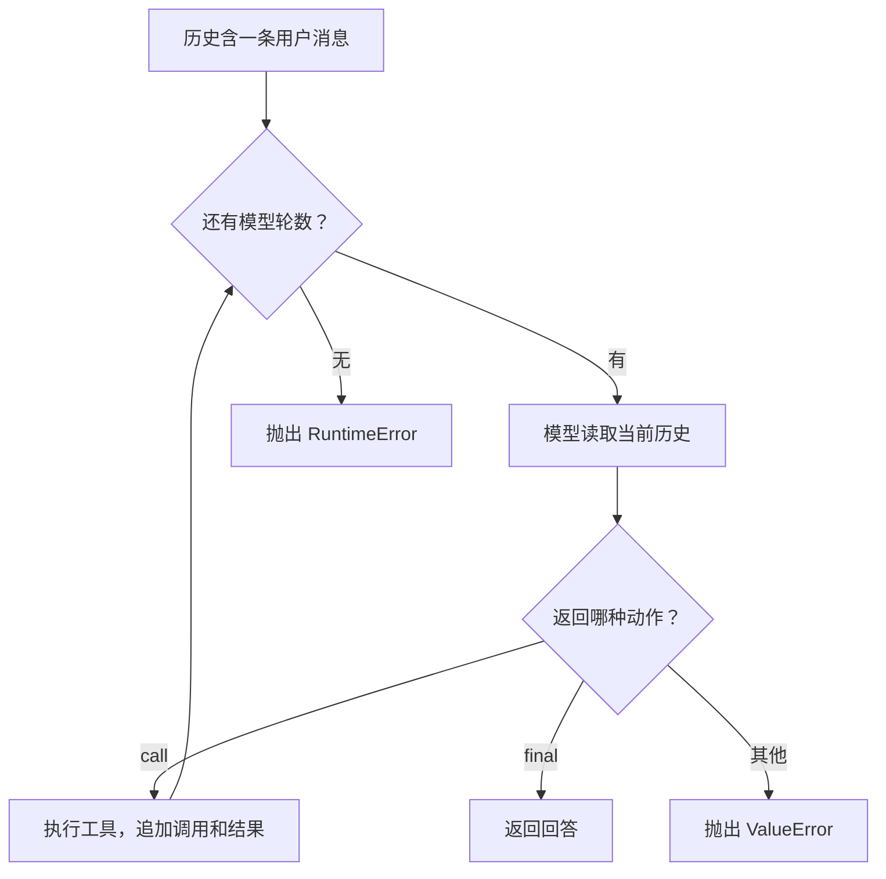

# 第 4 小时 · 为什么只问了一次，模型却运行两轮

试着把调试器停在 `result = tool(...)` 之后。此时 Python 已经拿到了「青禾自习室」和「北岸图书馆」，用户的屏幕上却一个字也没有。还缺哪一步？把断点向后移一行，就能看到答案：工具把结果交还给调用它的运行器，运行器还要把这个结果放进模型能读到的历史。

## 展开第一次工具调用

这段脚本暂时把循环拆开，用源码里的四个函数手工执行一轮。可以在每一行后检查 `history`。

```python
from agent_lab.core import demo_model, dispatch, make_message, record_call

history = [make_message("user", "安静")]
action = demo_model(history)
result = dispatch(action["name"], action["arguments"])
print(len(history), result)

record_call(history, action, result)
for message in history:
    print(message)

print(demo_model(history))
```

```text
1 {'ok': True, 'items': ['青禾自习室', '北岸图书馆']}
{'role': 'user', 'content': '安静'}
{'role': 'assistant', 'call': {'kind': 'call', 'id': 'c1', 'name': 'search_places', 'arguments': '{"query": "安静"}'}}
{'role': 'tool', 'call_id': 'c1', 'content': '{"ok": true, "items": ["青禾自习室", "北岸图书馆"]}'}
{'kind': 'final', 'text': '青禾自习室、北岸图书馆'}
```

留意第一行的 `1`。工具已经返回，历史里仍只有最初的用户消息。`record_call` 第一次追加记录“助手请求查地点”，第二次追加记录“工具返回这两个地点”。前者用 `id`，后者用 `call_id`，值同为 `c1`。一个工具可以被连续调用两次，名称相同，ID 可以把每份结果对回自己的请求。

工具消息的 `content` 里出现了小写 `true`。在工具刚返回时它是 Python 字典里的 `True`，写入历史时运行器用 `json.dumps` 把整个结果编码成文本。第二次执行 `demo_model(history)` 时，它看见末项来自工具，用 `json.loads` 读取结果，再把地点名用顿号连接。这样就能指出一条完整的因果关系：本例的最终文本取决于第二轮模型输入中的那一条工具消息。

## 把两次模型调用折回一个循环

`run_agent` 收到用户输入后反复调用 `model(history)`。这里的 `model` 是一个可以被调用的对象。源码把它的形状写为 `Callable[[list[dict]], dict]`。从里向外读，输入是一个由字典组成的列表，返回一个动作字典。熟悉 Java 的读者可以把它当作参数为 History、返回值为 Action 的函数式接口。这里的 **回调** 就是调用者传进函数，运行器在需要模型决策时再调用它。



图里有两种正常动作。`call` 让程序做事并回到循环开头；`final` 让程序交出文本并结束函数。Python 的 `return` 会直接退出整个函数，所以模型第一轮就回答时，工具一次也不会运行。`for _ in range(max_steps)` 只做有限次尝试，`_` 是习惯写法，表示这里用不到循环序号。

## 少给一轮，已经执行过的工具会怎样

下面用一个普通函数在真实执行之前记录工具名，再把它传给 `run_agent`。这种把具体依赖作为参数传入的写法，让我们能够观察调用次数。

```python
from agent_lab.core import dispatch, run_agent

calls = []

def counted_tool(name, raw):
    calls.append(name)
    return dispatch(name, raw)

try:
    run_agent("安静", tool=counted_tool, max_steps=1)
except RuntimeError as error:
    print(error)
print(calls)
```

```text
模型轮数已用尽
['search_places']
```

`max_steps=1` 允许模型决策一次。它请求查地点，工具照常执行，但预算已经没有第二次模型调用可以生成最终文本。这个实验也解释了一个工程问题：从外层看到“调用失败”，不能直接推断工具从未执行。重试看重的是实际执行记录，尤其当工具将来会产生写操作时。

## 写出自己的同步运行器

在 `practice.py` 完成 `run_agent`，为每次请求创建新的历史。保留传入的 `model` 和 `tool`，这样测试才可以替换它们。看到 `Tool | None = None` 时，竖线表示值允许是工具或 `None`，等号表示省略实参时使用 `None`。`record_call` 会就地修改列表，不必把返回值赋回 `history`。

执行 `python check.py 4` 和 `python -m agent_lab --practice 安静`。再把查询词换成「海滩」，预测工具消息中的 `ok`、`items` 和最终文本，然后用上面的逐行脚本核对。两个地点来源如果都要等待网络，循环最花时间的一步将变成等工具返回，这就是下一课的起点。[运行器源码](../agent_lab/core.py) · [练习文件](../practice.py) · [下一课：并发等待](05-async.md)
