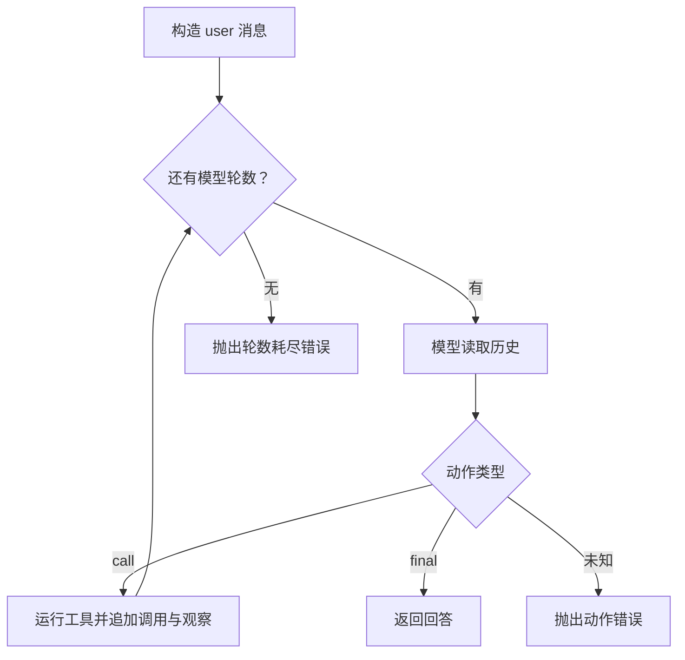

# 第 4 小时 · 用一段循环把工具结果交回模型

**本节产物**是一个同步的、可替换模型和工具的 Agent 循环。只完成前四小时，你就应能独立解释：为什么用户只发了一条消息，模型却被调用两次？

## 0–12 分钟 · 在纸上画出第二次模型调用的输入

在 [core.py](../agent_lab/core.py) 里从 `run_agent` 开始。初始历史只有 `{"role": "user", "content": "安静"}`。模型替身 `demo_model` 看到最后一条来自 user，就返回一个 `kind="call"` 的动作，其中包括工具名、参数文本和 ID。程序执行工具，再把助手动作和工具观察加入历史。第二轮模型能读取实际结果，从中拼出回答。

| 时刻 | 历史角色顺序 | 本次由谁产生什么 |
| --- | --- | --- |
| 第一轮开始 | user | 模型产生 `call`，ID 为 `c1` |
| 工具执行后 | user、assistant、tool | 运行器保存调用，再保存带有 `call_id="c1"` 的观察 |
| 第二轮开始 | user、assistant、tool | 模型读观察，返回 `kind="final"` |

动作 ID 和工具名各有作用。若模型连续两次请求同一工具，只靠工具名难以区分每个结果属于哪次调用。真实 SDK 在何处携带 ID 取决于协议；本练习明确把它存在 tool 消息中。



## 12–27 分钟 · 从签名推断执行者

读 `Model = Callable[[list[dict]], dict]`：调用者传一个消息列表，模型返回一个动作字典。两层方括号中，内层描述参数序列，最后的 `dict` 描述返回值。可把它理解为 Java 中一个接收消息列表、返回 Action 的函数式接口。`model(history)` 执行实际传进来的对象，入口没传参就使用默认的 `demo_model`。同理，`tool(name, raw)` 的实现也能替换。

做一个实验，只替换模型，其他部分复用现成代码：

```python
from agent_lab.core import run_agent

def answer_now(history):
    return {"kind": "final", "text": f"收到 {len(history)} 条消息"}

print(run_agent("你好", model=answer_now))
```

输出为 `收到 1 条消息`。此时工具没有执行。把 `answer_now` 改成总返回 `call`，并加上 `max_steps=2`，如果模型一直申请调用，程序最多执行两次工具，然后在循环尾抛错。这里的预算计量单位是**模型决策轮数**；一轮用来执行工具后，还需要一轮才能生成 final。

## 27–48 分钟 · 实现主循环

在 [practice.py](../practice.py) 实现 `run_agent`。每次调用单独构造历史，在 `for _ in range(max_steps)` 中调用一次模型。变量名 `_` 表示本段代码不读取计数值。遇到 final 立即 `return`。遇到 call 就调用工具并复用 `record_call(history, action, result)`。该辅助函数修改传入的列表，返回 `None`。遇到其他动作抛 `ValueError`；预算耗尽抛 `RuntimeError`，让最外层决定怎样展示。

```bash
python check.py 4
python -m agent_lab --practice 安静
python -m agent_lab --practice 海滩
```

第二条应返回两个地点，第三条应返回 `没有找到地点`。暂时在 `action = model(history)` 前打印 `[m["role"] for m in history]`，再运行一次，然后移除打印。观察是否和上表的两个输入快照一致。

## 48–60 分钟 · 入门结业挑战

从一个空白页写出 `fn = TOOLS[name]` 前后两步，以及 `action["arguments"]` 在哪一层从字符串变成对象。再用 `run_agent("安静", max_steps=1)` 制造一次失败：此时工具可能已执行，最终回答还未生成。由此解释为何不能用“模型轮数耗尽”推断“工具没有执行”。最后把模型改成直接回答，确认相同预算能得到最终文本。

遇到 `from .core import ...` 时，点表示从当前包解析模块。直接运行包内单文件可能缺少父包上下文，首页给出的 `-m` 命令会建立它。到这里，你已能读懂下一课会复用的同步逻辑。

[参考实现 · run_agent 与 record_call](../agent_lab/core.py) · [Python 教程 · 模块](https://docs.python.org/zh-cn/3.12/tutorial/modules.html)
