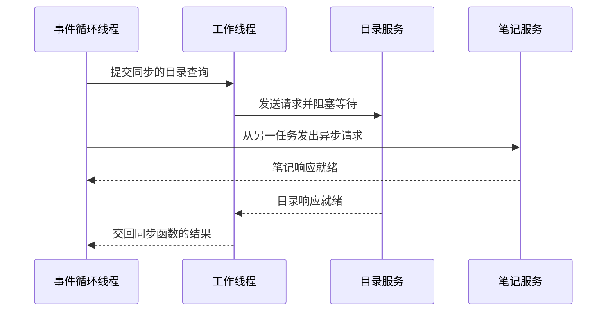

# 第 5 小时 · 一个线程怎样同时等待两份查询

现在给地点工具加一个来源。目录里有「青禾自习室、北岸图书馆」，笔记里有「青禾自习室、东桥阅览室」。两份查询相互独立。如果目录请求要等一秒才有响应，程序能否利用这一秒把笔记请求也发出去？要回答它，先分清三件事：创建一次查询、让查询开始运行、等待它的结果。

## 调用异步函数时，函数体还没开始

```python
import asyncio

async def search():
    print("进入查询")
    await asyncio.sleep(0)
    return ["青禾自习室"]

async def main():
    pending = search()
    print("拿到协程对象")
    names = await pending
    print(names)

asyncio.run(main())
```

```text
拿到协程对象
进入查询
['青禾自习室']
```

`async def` 定义协程函数；调用 `search()` 得到**协程对象**，它保留了这次调用要执行什么。`asyncio.run(main())` 启动**事件循环**，也就是不断挑选就绪任务、在等待完成后恢复它们的调度程序。执行到 `await pending` 时，当前任务开始驱动查询，并等它交回值。如果内部遇到尚未完成的异步等待，当前任务可以挂起，循环便有机会运行其他就绪任务。一个已经准备好的结果也可能直接返回，所以单单数一段代码里有几个 `await`，推断不出并发度。

在 Java 里，调用 `CompletableFuture.supplyAsync(...)` 通常已经提交了工作。这里单写一行 `pending = search()` 只创建协程对象。如果既不等待也不调度它，函数体里的打印不会出现。

## 把两个请求交给同一个事件循环

下面故意让目录等待笔记发出信号。`asyncio.Event` 是一个最初未置位的信号，`wait()` 等它，`set()` 唤醒等待者。这个小实验用先后关系证明并发，比比较两次只有几毫秒差异的计时更容易看清。

```python
import asyncio

async def main():
    note_started = asyncio.Event()

    async def catalog():
        print("目录开始，等待信号")
        await note_started.wait()
        print("目录恢复")
        return "目录结果"

    async def notes():
        print("笔记开始，发信号")
        note_started.set()
        return "笔记结果"

    results = await asyncio.gather(catalog(), notes())
    print(results)

asyncio.run(main())
```

```text
目录开始，等待信号
笔记开始，发信号
目录恢复
['目录结果', '笔记结果']
```

`gather` 接收两个协程并安排它们运行。目录在 `wait` 处暂停，事件循环所在的线程于是可以进入笔记函数。笔记完成后目录才恢复；最后的列表仍按传入 `gather` 的顺序排列。如果改写为 `a = await catalog()`、`b = await notes()`，第一次等待就永远等不到信号，程序没有机会进入第二行。第一个实验中有 `await`，第二个实验也有，真正改变行为的是两个任务何时被安排运行。

## 如果已有的客户端是同步的

假设已有 Java 风格的同步客户端，调用 `sync_search(query)` 会一直等到结果返回。直接在事件循环线程中调用时，这个线程会卡在函数内部，无法继续调度笔记查询。把 `await` 加在这个同步调用前也无法解决，因为 Python 先求出右边调用的结果，才尝试等待它。

下面用 `time.sleep` 模拟阻塞 I/O。`asyncio.to_thread` 接收**函数和实参**，让线程池里的工作线程替事件循环调用它。用线程标识验证两处代码运行在哪里，不用猜哪个系统线程叫哪个名字。

```python
import asyncio
import threading
import time

def sync_search(query):
    time.sleep(0.01)
    return query, threading.get_ident()

async def main():
    loop_thread = threading.get_ident()
    query, worker_thread = await asyncio.to_thread(sync_search, "安静")
    print(query, loop_thread == worker_thread)

asyncio.run(main())
```

```text
安静 False
```

这里的**工作线程**就是线程池拿来执行 `sync_search` 的另一个线程。如果写成 `to_thread(sync_search("安静"))`，内层调用会先在事件循环线程执行。若客户端本身已经提供异步查询，则让协程 `await` 它即可。两个来源并发等待 I/O 时，一条事件循环线程就足以管理它们，无须为每个异步请求单独分配线程。

把上面的阻塞调用放回双来源查询，会出现下图的时序。图中的笔记任务已经被调度。工作线程处理目录查询期间，事件循环线程可以推进笔记任务。图示只给出一种可能的完成顺序。



## 一个来源超时，另一份结果归谁

课程中的 `lookup_sources` 包装每个查询，并在单个来源内部执行 `await asyncio.wait_for(source(query), timeout=timeout_s)`。这样捕获 `TimeoutError` 时，还知道到底哪个来源超时。下面把一个永远没有信号的来源和一个立即返回的来源放在一起。

```python
import asyncio
from agent_lab.advanced import lookup_sources

async def stalled(query):
    await asyncio.Event().wait()

async def available(query):
    return [query]

async def main():
    rows = await lookup_sources("安静", {"目录": stalled, "笔记": available}, timeout_s=0.05)
    for row in rows:
        print(row)

asyncio.run(main())
```

```text
{'source': '目录', 'ok': False, 'error': 'timeout'}
{'source': '笔记', 'ok': True, 'items': ['安静']}
```

来源超时时 `wait_for` 会请求取消并等待取消完成，实际耗时可以超过 `timeout_s`。代码只把预期的超时转成来源记录。如果发生其他未捕获异常，默认的 `gather` 会向等待者抛出它。第 5 课的检查器也用信号构造了一个反例，串行实现会使本来可以成功的来源超时。[并发与超时文档](https://docs.python.org/zh-cn/3.12/library/asyncio-task.html)

在 `practice.py` 实现 `lookup_sources`，记得导入 `asyncio`。先把每个来源的协程收进 `jobs` 列表，再用 `await asyncio.gather(*jobs)`；调用端的星号将列表展开为多个位置实参。空来源应返回空列表。执行 `python check.py 5`。现在内部能并发查询了，但终端仍需等整次调用结束。下一课让调用者在结果到来前就看见一次调用的开始。[练习文件](../practice.py) · [异步工具源码](../agent_lab/advanced.py) · [下一课：流式事件](06-stream.md)
